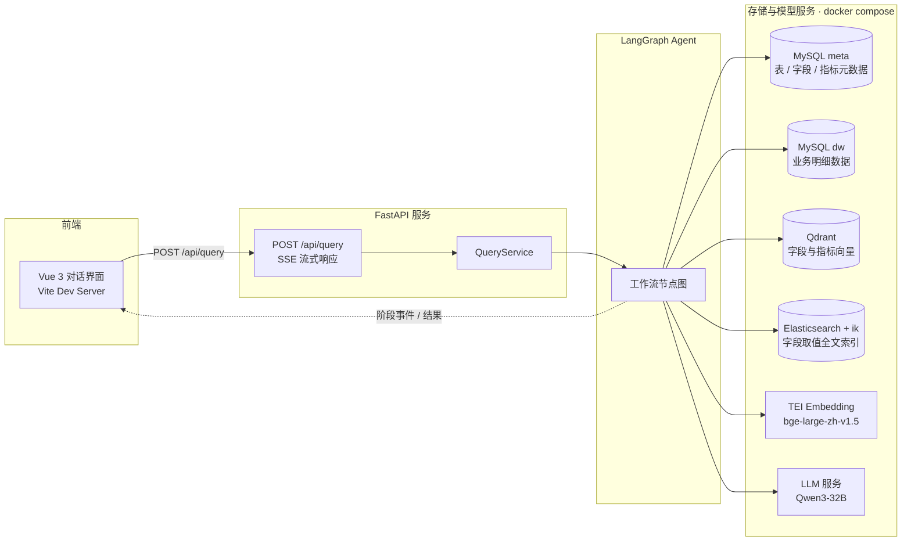
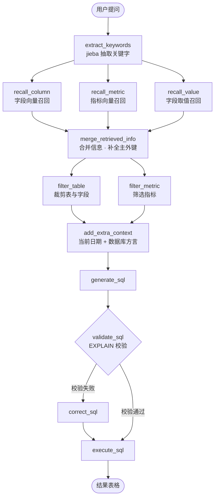

# shopkeeper-data-agent

面向电商 / 零售场景的自然语言数据分析 Agent（NL2SQL）：用一句中文提问，自动完成元数据召回、Schema 裁剪、SQL 生成与校验、查询执行，并把整个推理过程流式推送到前端界面。

例如输入「统计华北地区销售总额」，Agent 会依次展示召回字段 → 召回指标 → 过滤表 → 生成 SQL → 校验并执行，最后以表格形式返回查询结果。

## 核心特性

- **自然语言转 SQL**：中文口语化提问直接产出可执行的 MySQL 查询。
- **三层元数据召回**：字段向量召回（Qdrant）+ 字段取值全文召回（Elasticsearch）+ 指标向量召回（Qdrant），覆盖「字段语义、字段取值、业务指标」三类知识。
- **LLM 关键词语义扩展**：先用 jieba 抽词，再让 LLM 按字段、取值、指标三个维度扩展召回关键词，缓解分词歧义与口语表达问题。
- **Schema 裁剪**：由 LLM 从召回结果中裁剪出真正用到的表、字段与指标，减少提示词噪声、提升 SQL 准确率。
- **主外键自动补全**：合并召回信息时按元数据补齐相关表的主键 / 外键，保证多表 JOIN 的条件正确。
- **SQL 校验与自动纠错**：先用 `EXPLAIN` 校验语法与语义，失败时携带错误信息让 LLM 做最小必要修复后重新执行。
- **全流程流式输出**：每个节点通过 SSE 上报执行阶段，前端实时可视化推理链路。
- **只读安全**：提示词约束 LLM 只生成查询语句，不产生任何写操作。

## 系统架构



## Agent 工作流

基于 LangGraph `StateGraph` 构建，节点间按「并行召回 → 合并 → 裁剪 → 生成 → 校验 → 纠错 → 执行」的链路编排：



| 节点 | 职责 | 依赖组件 |
| --- | --- | --- |
| `extract_keywords` | jieba 按词性抽取关键字，并保留原句兜底 | jieba |
| `recall_column` | LLM 扩展字段关键词 → 向量检索列信息 | LLM + TEI + Qdrant |
| `recall_metric` | LLM 扩展指标关键词 → 向量检索指标定义 | LLM + TEI + Qdrant |
| `recall_value` | LLM 扩展取值候选 → 全文检索字段取值 | LLM + Elasticsearch |
| `merge_retrieved_info` | 合并字段 / 取值 / 指标，补齐关联字段与主外键，按表重组 Schema | MySQL meta |
| `filter_table` | LLM 裁剪出必需的表与字段 | LLM |
| `filter_metric` | LLM 筛出本次查询真正使用的指标 | LLM |
| `add_extra_context` | 注入当前日期、星期、季度与数据库版本 / 方言 | MySQL dw |
| `generate_sql` | 依据 Schema、指标口径、时间与方言生成 SQL | LLM |
| `validate_sql` | `EXPLAIN` 校验，返回错误信息驱动分支 | MySQL dw |
| `correct_sql` | 携带错误信息做最小必要修复 | LLM |
| `execute_sql` | 执行 SQL 并回写结果集 | MySQL dw |

## 技术栈

| 层次 | 选型 |
| --- | --- |
| Web 框架 | FastAPI + Uvicorn（`fastapi[standard]`）、SSE 流式响应 |
| Agent 编排 | LangGraph（StateGraph + 自定义流事件） |
| LLM 接入 | LangChain + 硅基流动（SiliconFlow）OpenAI 兼容接口，默认 `Qwen/Qwen3-32B` |
| 向量库 | Qdrant（字段集合 `data-agent-column`、指标集合 `data-agent-metrics`） |
| 全文检索 | Elasticsearch 8 + IK 中文分词（索引 `data-agent-values`） |
| 关系库 | MySQL 8 + SQLAlchemy 2（asyncmy 驱动），`meta` 存元数据、`dw` 存业务数据 |
| 向量化 | HuggingFace Text Embeddings Inference 部署 `BAAI/bge-large-zh-v1.5`（1024 维） |
| 中文分词 | jieba（关键词抽取） |
| 配置 / 日志 | OmegaConf + dataclass、loguru（按 request_id 串联链路） |
| 前端 | Vue 3 + Vite 7，原生 fetch 消费 SSE |
| 依赖管理 | uv（`pyproject.toml` + `uv.lock`） |

## 目录结构

```
shopkeeper-data-agent
├── main.py                       # FastAPI 入口，注册路由与 request_id 中间件
├── pyproject.toml / uv.lock      # 依赖声明与锁定
├── conf/
│   ├── app_config.yaml           # 数据库 / 向量库 / ES / LLM 连接配置
│   └── meta_config.yaml          # 业务元数据：表、字段、指标口径
├── prompts/                      # 各 LLM 节点的提示词模板
├── app/
│   ├── agent/                    # 图、状态、运行时上下文与全部节点
│   ├── api/                      # 路由、依赖注入、请求响应模型
│   ├── clients/                  # MySQL / Qdrant / ES / TEI 客户端管理器
│   ├── repositories/             # 各存储的读写封装
│   ├── services/                 # 查询业务、元数据知识库构建
│   ├── scripts/                  # 知识库构建入口脚本
│   ├── models/                   # 实体模型（mysql / qdrant / es）
│   ├── conf/                     # 配置数据类
│   └── core/                     # 日志、上下文变量、生命周期
├── docker/
│   ├── docker-compose.yaml       # MySQL / ES + Kibana / Qdrant / TEI 编排
│   ├── mysql/                    # meta.sql、dw.sql 初始化脚本与示例数据
│   ├── elasticsearch/            # 内置 IK 分词的 ES 镜像
│   └── embedding/                # bge-large-zh-v1.5 模型目录（需自行下载）
└── frontend/                     # Vue 3 对话界面
```

## 快速开始

### 环境要求

- Python 3.11+ 与 [uv](https://docs.astral.sh/uv/)
- Node.js 18+（前端 Vite 7）
- Docker 与 Docker Compose
- 一个 OpenAI 兼容的 LLM API Key（默认对接硅基流动）

### 1. 启动依赖组件

```bash
cd docker
docker compose up -d
```

启动后会得到以下服务：

| 服务 | 地址 | 说明 |
| --- | --- | --- |
| MySQL | `localhost:3306` | 首次启动自动执行 `mysql/meta.sql`、`mysql/dw.sql`，创建 `meta`、`dw` 库与示例数据 |
| Elasticsearch | `localhost:9200` | 内置 IK 分词插件，关闭安全认证 |
| Kibana | `localhost:5601` | 便于查看索引数据 |
| Qdrant | `localhost:6333` / `6334` | HTTP / gRPC |
| TEI Embedding | `localhost:8081` | 加载 `/models/bge-large-zh-v1.5`（容器内 80 端口） |

> `.sql` 初始化脚本只在 MySQL 数据卷为空时执行；需要重建数据时先删除 `mysql_data` 卷。

**先下载向量模型**：`docker/embedding/bge-large-zh-v1.5` 需要放置 `BAAI/bge-large-zh-v1.5` 模型文件（`pytorch_model.bin`、`config.json`、`tokenizer.json` 等）。该模型约 1.2 GB，建议从 HuggingFace 下载后放入该目录，不要提交到版本库。

### 2. 安装 Python 依赖

```bash
uv sync
```

### 3. 调整配置

编辑 `conf/app_config.yaml`，确认各组件连接信息与 LLM 凭据：

| 配置项 | 说明 |
| --- | --- |
| `db_meta` / `db_dw` | `meta` 元数据库与 `dw` 业务库的 host / port / user / password / database |
| `qdrant` | Qdrant 地址与 `embedding_size`（需与向量模型维度一致，bge-large-zh-v1.5 为 1024） |
| `embedding` | TEI 服务地址与模型名 |
| `es` | Elasticsearch 地址与索引名 |
| `llm` | `model_name` 与 `api_key`（默认走硅基流动 OpenAI 兼容接口） |
| `logging` | 控制台与文件日志的开关、级别、切分与保留策略 |

> `api_key` 建议通过环境变量注入，避免把真实密钥提交到仓库。

### 4. 构建元数据知识库

```bash
uv run python -m app.scripts.build_meta_knowledge -c conf/meta_config.yaml
```

该脚本按 `conf/meta_config.yaml` 完成四件事：

1. 表信息、字段信息写入 `meta` 库（`table_info`、`column_info`）。
2. 字段名 / 描述 / 别名向量化写入 Qdrant 集合 `data-agent-column`。
3. `sync: true` 的字段取值采样后写入 Elasticsearch 索引 `data-agent-values`。
4. 指标定义与别名向量化写入 Qdrant 集合 `data-agent-metrics`（并落库 `metric_info`、`column_metric`）。

### 5. 启动后端

```bash
uv run fastapi dev main.py
```

服务监听 `http://localhost:8000`，交互式接口文档见 `http://localhost:8000/docs`。应用启动时会通过 lifespan 初始化 MySQL / Qdrant / ES / Embedding 客户端，关闭时统一释放。

### 6. 启动前端

```bash
cd frontend
npm install
npm run dev
```

打开 `http://localhost:5173` 即可对话。Vite 已配置代理，把 `/api` 请求转发到 `http://localhost:8000`。

## 接口说明

### `POST /api/query`

请求体：

```json
{ "query": "统计华北地区销售总额" }
```

响应类型为 `text/event-stream`，每个事件为一行 `data: {json}`，共三种负载：

| 负载 | 含义 |
| --- | --- |
| `{"stage": "生成sql"}` | 当前执行到的阶段，前端渲染为步骤条 |
| `{"result": [{"字段": "值"}]}` | 最终查询结果集，前端渲染为表格 |
| `{"error": "..."}` | 节点异常信息，前端高亮提示 |

### `GET /api/stream`

内置的 SSE 演示接口，用于前端联调。

## 元数据配置

`conf/meta_config.yaml` 是 Agent 理解业务的口径来源，结构如下：

```yaml
tables:
  - name: fact_order          # 表名
    role: fact                # fact / dim
    description: 订单事实表
    columns:
      - name: order_amount
        role: measure         # primary_key / foreign_key / measure / dimension
        description: 订单成交金额
        alias: [ 销售额, 成交额 ]
        sync: false           # 是否将字段取值同步到 ES 全文索引

metrics:
  - name: GMV
    description: 全称 Gross Merchandise Value，表示所有订单的成交金额总和
    relevant_columns:
      - fact_order.order_amount
    alias: [ 成交总额, 订单总额 ]
```

约定的关键语义：

- `role` 区分主键 / 外键 / 度量 / 维度，生成 SQL 时会用主外键角色的字段做多表关联。
- `alias` 提供字段与指标的中文别名，是向量召回的主要命中来源。
- `sync: true` 的字段取值会进入 ES 全文索引，用于把「华北」「黄金」这类取值映射回具体字段。
- `metrics` 中的口径会被写入提示词，LLM 生成 SQL 时需严格遵循，不得重解释。

## 示例问题

- 统计华北地区销售总额
- 各品类销售额排名
- 华东地区黄金会员的客单价是多少
- 按月份统计订单量趋势

## 已知问题与后续计划

- **平台迁移风险**：`app/core/log.py`、`app/scripts/build_meta_knowledge.py`、`app/services/meta_knowledge_service.py` 使用了 `from Lib import uuid / argparse`、`from Lib.dataclasses import asdict`。目前在 Windows 虚拟环境中因 `.venv/Lib` 恰好可作为命名空间包解析而可用，迁移到 Linux 或容器环境会导入失败，应改为 `import uuid` / `import argparse` / `from dataclasses import asdict`。
- **SQL 规划节点未接入**：`prompts/plan_sql.prompt` 已具备完整的查询规划提示词，但尚未注册到 `app/agent/graph.py`。
- **知识库构建不幂等**：重复执行构建脚本会重复写入元数据与向量，需要重建时应先清空 `meta` 库与相应 Qdrant 集合 / ES 索引。
- **密钥管理**：LLM 密钥目前明文写在 `conf/app_config.yaml`，建议改用环境变量或密钥管理服务。
- **服务无鉴权与限流**：后端接口与依赖组件均为本地单机部署形态，未做认证、限流与多租户隔离。
- **可观测性**：日志已按 `request_id` 串联，但缺少指标采集与链路追踪。

## 开源协议

项目尚未声明开源协议，如需对外发布请补充 `LICENSE` 文件。
